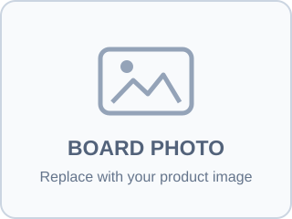

<p align="center">
  
</p>

# YOUR_VENDOR_NAME ESP Board Manager 板组件

[English](README.md)

本组件提供 YOUR_VENDOR_NAME 开发板的 ESP Board Manager YAML 定义，可从 [ESP 组件注册库](https://components.espressif.com) 下载并在应用工程中选择。

> 模板提示：将自己的厂商头图和板卡实物图上传到 `docs/images/`，直接修改两份 README 中的图片 `src` 路径和产品链接。

## 支持的开发板

可根据板卡图片和已配置的设备选板，并将板卡 ID 用于 `idf.py bmgr -b`。点击图片或板名可查看产品资料或板卡配置目录。

下表概括已配置的音频、SD 卡、LCD、触摸、摄像头、按键、LED 灯带、旋钮和以太网九类能力，不代表实物硬件的完整清单。

<!-- BEGIN SUPPORTED_BOARDS -->
### ESP32-S3

| 板卡图片 | 开发板 | 芯片 | 设备能力 |
| --- | --- | --- | --- |
| <a href="example_board"></a> | <a href="example_board">Example Board</a><br><code>example_board</code> | ESP32-S3 | 未配置上述设备能力 |
<!-- END SUPPORTED_BOARDS -->

## 在应用工程中使用本组件

在已激活的 ESP-IDF Python 环境中安装一次辅助工具：

```bash
python -m pip install --upgrade esp-bmgr-assist
```

添加已发布的组件后，选择开发板：

```bash
idf.py add-dependency "YOUR_NAMESPACE/YOUR_COMPONENT_NAME"
idf.py bmgr -l
idf.py bmgr -b <board_name>
idf.py build
```

本板组件已声明 `espressif/esp_board_manager` 依赖。除非应用需要更严格的版本限制，否则不必再次添加。

## 厂家维护指南

从本模板创建仓库、迁移现有 BSP、配置 CI 和发布组件，请参见 [VENDOR_GUIDE_CN.md](VENDOR_GUIDE_CN.md)。

## 许可证

本组件采用 Apache-2.0。迁移 BSP 或引入第三方内容时，请保留并遵守其原有版权声明和许可证。
